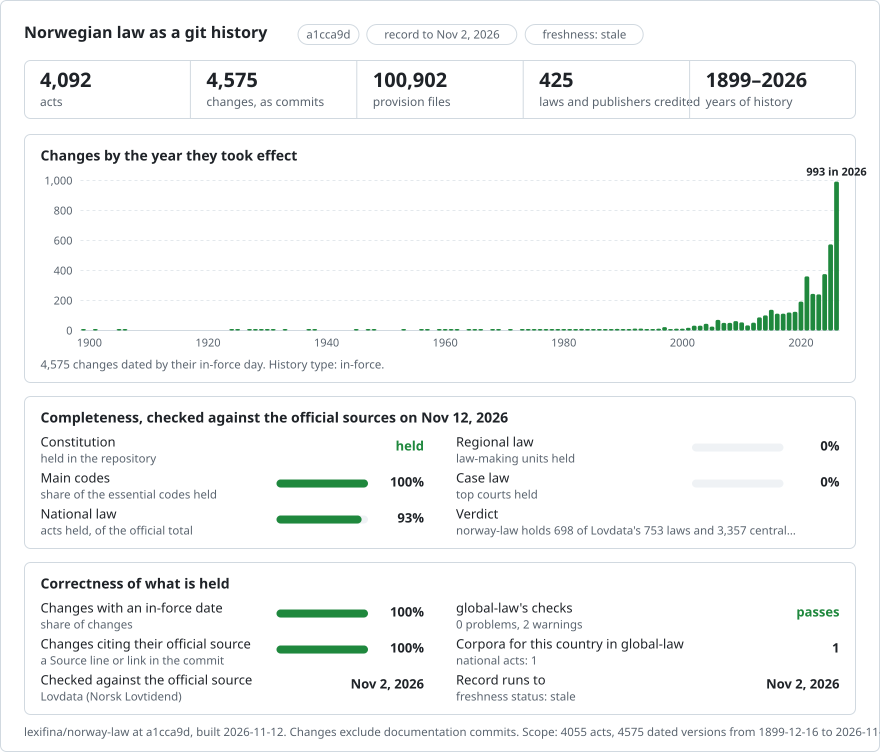

# Norway: law history in git

**English** · **[Eller les på norsk](README.md)**

<picture>
<source media="(prefers-color-scheme: dark)" srcset="data/effort-dark.svg">

</picture>

The law of Norway as a git history: one file per provision, one commit per version on the day it took effect, and the law or decision that made each change as the commit's author. `git blame` names the law behind every ledd; `git log` lists every change to a paragraph; picking a date gives the text in force that day.

Part of [lexifina/global-law](https://github.com/lexifina/global-law), one git history for every country's law: this is Norway's national law, which global-law reads at `norway/national/acts/`.

**What is in it now:** the Constitution, in its bokmål and nynorsk texts, and 29 other laws, replayed from every announcement in Norsk Lovtidend, with 633 versions; and 4,061 further acts with their current text only, as Lovdata consolidates them (673 laws and 3,388 central regulations; 37 of them are not yet in force, so not yet on `main`). Each act's folder has a `README.md` listing every provision, how often it changed and when ([`arbeidsmiljoloven/README.md`](arbeidsmiljoloven/README.md)); [`REPRODUCE.md`](REPRODUCE.md) lists every act with its versions.

Each act is a folder named after its short title, or after its Lovtidend id when it has none (`arbeidsmiljoloven/` is the Lov om arbeidsmiljø, arbeidstid og stillingsvern mv., the Working Environment Act, lov 17. juni 2005 nr. 62; `for-2013-08-19-1000/` is a regulation of 19 August 2013); each paragraph is a file (`paragraf-14-009.md` is § 14-9), and so is each chapter heading.

The text is in Norwegian, bokmål or nynorsk as each act was made (older acts in the spelling of their day), as Lovtidend and Lovdata print it. An English translation is not part of this record.

## Questions as git commands

| Question | Command |
| --- | --- |
| Every change to § 14-9 of the Working Environment Act | `git log -p --word-diff -- arbeidsmiljoloven/paragraf-14-009.md` |
| Which law wrote each ledd of § 14-9? | `git blame arbeidsmiljoloven/paragraf-14-009.md` |
| Every version of the Working Environment Act, with the day each took effect | `git log --format="%h %(trailers:key=In-force,valueonly,separator=) %an" -- arbeidsmiljoloven` |
| § 14-9 as in force on 1 January 2015 | `python tools/gjeldende.py 2015-01-01 arbeidsmiljoloven 14-9` |

**Outside git**, we also host this record publicly, for free:

- **[Ask Claude about Norwegian law](https://global-law.lexifina.com/v1/try_claude?country=norway)**: opens Claude with a first question ready.
- **[Ask ChatGPT](https://global-law.lexifina.com/v1/try_chatgpt?country=norway)**: the same question in ChatGPT.
- **[Search Norwegian law on our site](https://lexifina.com/law?country=norway&q=feriepenger)**: a search for "feriepenger" (holiday pay), with each provision's text and its versions, no account needed.
- **[Developer REST API](https://global-law.lexifina.com/v1/search_law?query=feriepenger&jurisdiction=norway)**: the same search as JSON, with no key. See the [documentation here](https://lexifina.com/api/global-law).

Both assistants read the record through the free Global law connector (MCP, `https://global-law.lexifina.com/mcp`); the first time, the chat gives you the link that adds it. Ask in Norwegian or in English.

**Host it yourself easily.** All it takes is git and Python, and the tools run on your machine:

```sh
git clone --depth 1 https://github.com/lexifina/global-law && cd global-law
python3 tools/countries.py add norway/national/acts
python3 tools/law.py show 2026-01-01 norway/national/acts/arbeidsmiljoloven/paragraf-14-009.md
```

Opened in Claude Code, Cursor, VS Code or Codex, the clone also starts a local MCP server with the same tools ([MCP.md](https://github.com/lexifina/global-law/blob/main/MCP.md)).

## Dates

Each commit is dated at noon, Europe/Oslo, on the day the version took effect, and carries it in its `In-force:` trailer:

- for an amendment to the Constitution, the day of Stortinget's decision, which is the "I kraft fra" day Lovdata gives its announcement;
- for a law, the day Lovdata's amendment note gives for the provision (most laws leave commencement to the King, and the note names the resolution), else the first day in the law's own "I kraft fra" field. A change passed with no day set yet is not in the history; one due later is on the `fremtidig` branch until its day;
- for an act with its current text only, the day Lovdata gives for its last change in force, or its own in-force day;
- git cannot store dates before 1970, so the 41 earlier commits are dated 1 January 1970, with the real day in `In-force:`. Ask for a date with `tools/gjeldende.py`, not `git log --before`.

Each change is credited to the law or decision that made it, as Lovtidend names it (`Lov 17. mars 2023 nr. 3`, `lov-2023-03-17-3@lovdata.invalid`); no change is left unexplained. The first text of Grunnloven and Grunnlova (the language revision of 6 May 2014) and every current-text act are the "oldest version available", credited to Lovdata as publisher.

## How it is checked

- The amendment instructions in each announcement ("§ 5 første punktum skal lyde:", "§ 101 tredje ledd oppheves.") are applied by code to the text before it; an instruction the code cannot read stops the build, and the few left unapplied are listed in `REPRODUCE.md`.
- After the replay, each of the 31 acts matches Lovdata's consolidated text of 21 October 2026 in every provision, except where the official Lovtidend wording is kept over Lovdata's editing; `REPRODUCE.md` lists each place.
- Each current-text act has exactly the paragraphs its consolidated document lists, and its words, in order, are the document's own.
- `tools/check_repo.py` reads every version back from git on the day it took effect and on the day before and compares it with the corpus; it also checks that every commit's trailers parse, that there are no merge commits and that no commit date goes backwards or lies in the future.

## What it does not show

- **History for most acts.** The 4,061 current-text acts have one version each, Lovdata's unofficial consolidation; only the 31 replayed acts have every version.
- **The Constitution before 6 May 2014.** Lovtidend's open data starts in 2001 and has no full text in the older language to replay its amendments on.
- **Changes with no commencement day yet** ("fra den tid Kongen bestemmer"), until a day is set.
- **Annexes and images**: the GDPR text annexed to personopplysningsloven, annexed conventions and EU acts, and images in a few regulations. Lovdata's editorial notes are not law text and are left out.
- **98 acts held back** for no stated or a conditional in-force day, a day after the data set's, or no usable text; also local regulations, and the delegation decisions and instructions in the regulations data set.
- **Case law.** None is here.

## Sources

| Source | Kind | Past versions | Notes |
| --- | --- | --- | --- |
| [Norsk Lovtidend avd. I](https://api.lovdata.no/publicData) (Lovdata public data) | Official gazette | every announcement since 1 January 2001 | The text of every version of the 31 replayed acts |
| [Gjeldende lover](https://api.lovdata.no/v1/publicData/get/gjeldende-lover.tar.bz2) (Lovdata public data) | Unofficial consolidation | current text only | Checks the replay and gives in-force days; the text of the current-text laws |
| [Gjeldende sentrale forskrifter](https://api.lovdata.no/v1/publicData/get/gjeldende-sentrale-forskrifter.tar.bz2) (Lovdata public data) | Unofficial consolidation | current text only | The text of the central regulations |

## Licence

See [`LICENSE`](LICENSE). Laws and decisions of public authorities are not protected by copyright in Norway (åndsverkloven, lov 15. juni 2018 nr. 40, § 14); Lovdata releases its public data under NLOD 2.0 ("Contains data under the Norwegian licence for Open Government data (NLOD) distributed by Lovdata"). Lexifina's arrangement, commit messages, tables and tools are CC0 1.0.

No AI model wrote, translated or corrected legal text, and none runs when the history is built; the scripts were written by an AI model (see [`REPRODUCE.md`](REPRODUCE.md)).

## More

From [lexifina/global-law](https://github.com/lexifina/global-law):

- [FEATURES.md](https://github.com/lexifina/global-law/blob/main/FEATURES.md): every feature, and what every corpus must support (`git blame`, `law.py`, the MCP tools)
- [FAQ.md](https://github.com/lexifina/global-law/blob/main/FAQ.md): questions and answers · [CONTRIBUTING.md](https://github.com/lexifina/global-law/blob/main/CONTRIBUTING.md): proposing changes · [MCP.md](https://github.com/lexifina/global-law/blob/main/MCP.md): the MCP server · [REPRODUCE.md](https://github.com/lexifina/global-law/blob/main/REPRODUCE.md): how it was built · [CHANGELOG.md](https://github.com/lexifina/global-law/blob/main/CHANGELOG.md)
- [FRESHNESS.md](https://github.com/lexifina/global-law/blob/main/FRESHNESS.md): how current each corpus is · [Monitoring](https://github.com/lexifina/global-law/tree/main/monitoring): whether updates are running · [WATCHING.md](https://github.com/lexifina/global-law/blob/main/WATCHING.md): how each official source is watched for changes
- [performance/](https://github.com/lexifina/global-law/tree/main/performance): how fast the tools are, measured
- [visualisations/](https://github.com/lexifina/global-law/tree/main/visualisations): charts and bridges across the world's law
- [Vulnerabilities](https://github.com/lexifina/global-law/tree/main/vulnerabilities): mistakes in legislation as published
