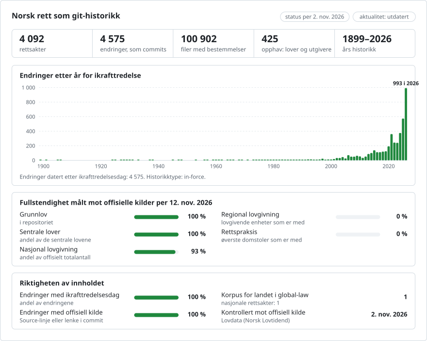

# Norge: lovhistorie i git

**Norsk bokmål** · **[Or read it in English](README.en.md)**

<picture>
<source media="(prefers-color-scheme: dark)" srcset="data/nb/effort-dark.svg">

</picture>

Norges lovgivning som git-historikk: én fil per bestemmelse, én commit per versjon på dagen den trådte i kraft, og loven eller vedtaket som gjorde hver endring, som forfatter av commiten. `git blame` viser loven bak hvert ledd; `git log` lister hver endring i en paragraf; velger man en dato, får man teksten som gjaldt den dagen.

Del av [lexifina/global-law](https://github.com/lexifina/global-law), én git-historikk for alle lands rett: dette er Norges nasjonale lovgivning, som global-law leser under `norway/national/acts/`.

**Hva det inneholder nå:** Grunnloven, i bokmåls- og nynorskteksten, og 29 andre lover, avspilt fra hver kunngjøring i Norsk Lovtidend, med 633 versjoner; og 4 061 andre rettsakter med bare gjeldende tekst, slik Lovdata konsoliderer dem (673 lover og 3 388 sentrale forskrifter; 37 av dem er ennå ikke i kraft og derfor ennå ikke på `main`). Mappen til hver rettsakt har en `README.md` som lister opp hver bestemmelse, hvor ofte den er endret og når ([`arbeidsmiljoloven/README.md`](arbeidsmiljoloven/README.md)); [`REPRODUCE.md`](REPRODUCE.md) lister opp hver rettsakt med versjonene.

Hver rettsakt er en mappe oppkalt etter korttittelen, eller etter Lovtidend-id-en når den ikke har noen (`arbeidsmiljoloven/` er lov om arbeidsmiljø, arbeidstid og stillingsvern mv., lov 17. juni 2005 nr. 62; `for-2013-08-19-1000/` er en forskrift av 19. august 2013); hver paragraf er én fil (`paragraf-14-009.md` er § 14-9), og det samme er hver kapitteloverskrift.

Teksten er på norsk, bokmål eller nynorsk slik hver rettsakt ble vedtatt (eldre rettsakter med sin tids rettskrivning), slik Lovtidend og Lovdata trykker den. En engelsk oversettelse er ikke en del av denne historikken.

## Spørsmål som git-kommandoer

| Spørsmål | Kommando |
| --- | --- |
| Hver endring i arbeidsmiljøloven § 14-9 | `git log -p --word-diff -- arbeidsmiljoloven/paragraf-14-009.md` |
| Hvilken lov skrev hvert ledd i § 14-9? | `git blame arbeidsmiljoloven/paragraf-14-009.md` |
| Hver versjon av arbeidsmiljøloven, med dagen hver av dem trådte i kraft | `git log --format="%h %(trailers:key=In-force,valueonly,separator=) %an" -- arbeidsmiljoloven` |
| § 14-9 slik den gjaldt 1. januar 2015 | `python tools/gjeldende.py 2015-01-01 arbeidsmiljoloven 14-9` |

**Utenfor git** tilbyr vi også denne historikken offentlig og gratis:

- **[Spør Claude om norsk rett](https://global-law.lexifina.com/v1/try_claude?country=norway)**: åpner Claude med et første spørsmål klart.
- **[Spør ChatGPT](https://global-law.lexifina.com/v1/try_chatgpt?country=norway)**: det samme spørsmålet i ChatGPT.
- **[Søk i norsk rett på nettstedet vårt](https://lexifina.com/law?country=norway&q=feriepenger)**: et søk etter «feriepenger», med teksten i hver bestemmelse og versjonene av den, uten konto.
- **[REST-API for utviklere](https://global-law.lexifina.com/v1/search_law?query=feriepenger&jurisdiction=norway)**: det samme søket som JSON, uten nøkkel. Dokumentasjonen finner du [her](https://lexifina.com/api/global-law).

Begge assistentene leser historikken gjennom den gratis Global law-koblingen (MCP, `https://global-law.lexifina.com/mcp`); første gang gir chatten deg lenken som legger den til. Spør på norsk eller engelsk.

**Kjør det enkelt selv.** Alt som trengs, er git og Python, og verktøyene kjører på din egen maskin:

```sh
git clone --depth 1 https://github.com/lexifina/global-law && cd global-law
python3 tools/countries.py add norway/national/acts
python3 tools/law.py show 2026-01-01 norway/national/acts/arbeidsmiljoloven/paragraf-14-009.md
```

Åpnet i Claude Code, Cursor, VS Code eller Codex starter klonen også en lokal MCP-server med de samme verktøyene ([MCP.md](https://github.com/lexifina/global-law/blob/main/MCP.md)).

## Datoer

Hver commit er datert kl. 12.00, Europe/Oslo, på dagen versjonen trådte i kraft, og har dagen i traileren `In-force:`:

- for en endring i Grunnloven, dagen for Stortingets vedtak, som er den «I kraft fra»-dagen Lovdata oppgir for kunngjøringen;
- for en lov, dagen Lovdatas endringsnote oppgir for bestemmelsen (de fleste lover overlater ikrafttredelsen til Kongen, og noten angir resolusjonen), ellers den første dagen i lovens eget «I kraft fra»-felt. En endring som er vedtatt uten at noen dag er fastsatt ennå, er ikke med i historikken; en som trer i kraft senere, ligger på grenen `fremtidig` fram til dagen sin;
- for en rettsakt med bare gjeldende tekst, dagen Lovdata oppgir for den siste endringen i kraft, eller rettsaktens egen ikrafttredelsesdag;
- git kan ikke lagre datoer før 1970, så de 41 tidligere commitene er datert 1. januar 1970, med den virkelige dagen i `In-force:`. Spør etter en dato med `tools/gjeldende.py`, ikke med `git log --before`.

Hver endring tilskrives loven eller vedtaket som gjorde den, slik Lovtidend navngir det (`Lov 17. mars 2023 nr. 3`, `lov-2023-03-17-3@lovdata.invalid`); ingen endring står uforklart. Den første teksten av Grunnloven og Grunnlova (språkrevisjonen 6. mai 2014) og hver rettsakt med bare gjeldende tekst er «oldest version available» (eldste tilgjengelige versjon), tilskrevet Lovdata som utgiver.

## Slik kontrolleres det

- Endringsinstruksjonene i hver kunngjøring («§ 5 første punktum skal lyde:», «§ 101 tredje ledd oppheves.») anvendes av kode på teksten før dem; en instruksjon koden ikke kan lese, stopper byggingen, og de få som ikke er anvendt, er oppført i `REPRODUCE.md`.
- Etter avspillingen stemmer hver av de 31 lovene med Lovdatas konsoliderte tekst av 21. oktober 2026 i hver bestemmelse, unntatt der den offisielle ordlyden i Lovtidend er beholdt framfor Lovdatas redigering; `REPRODUCE.md` lister opp hvert sted.
- Hver rettsakt med bare gjeldende tekst har nøyaktig de paragrafene det konsoliderte dokumentet lister opp, og ordene, i rekkefølge, er dokumentets egne.
- `tools/check_repo.py` leser hver versjon tilbake fra git på dagen den trådte i kraft og dagen før, og sammenligner den med korpuset; det kontrollerer også at trailerne i hver commit kan tolkes, at det ikke finnes merge-commits, og at ingen commit-dato går bakover eller ligger i framtiden.

## Hva det ikke viser

- **Historikk for de fleste rettsakter.** De 4 061 rettsaktene med bare gjeldende tekst har én versjon hver, Lovdatas uoffisielle konsolidering; bare de 31 avspilte lovene har hver versjon.
- **Grunnloven før 6. mai 2014.** Lovtidends åpne data begynner i 2001 og har ingen fullstendig tekst på det eldre språket å spille endringene av på.
- **Endringer uten ikrafttredelsesdag ennå** («fra den tid Kongen bestemmer»), før en dag er fastsatt.
- **Vedlegg og bilder**: GDPR-teksten som er vedlagt personopplysningsloven, vedlagte konvensjoner og EU-rettsakter, og bilder i noen få forskrifter. Lovdatas redaksjonelle merknader er ikke lovtekst og er utelatt.
- **98 rettsakter som er holdt tilbake** fordi de ikke har noen angitt eller bare en betinget ikrafttredelsesdag, har en dag etter datasettets, eller mangler brukbar tekst; heller ikke lokale forskrifter, eller delegeringsvedtakene og instruksene i forskriftsdatasettet.
- **Rettspraksis.** Ingen er med.

## Kilder

| Kilde | Type | Tidligere versjoner | Merknader |
| --- | --- | --- | --- |
| [Norsk Lovtidend avd. I](https://api.lovdata.no/publicData) (Lovdatas åpne data) | Offisiell kunngjøringstidende | hver kunngjøring siden 1. januar 2001 | Teksten i hver versjon av de 31 avspilte lovene |
| [Gjeldende lover](https://api.lovdata.no/v1/publicData/get/gjeldende-lover.tar.bz2) (Lovdatas åpne data) | Uoffisiell konsolidering | bare gjeldende tekst | Kontrollerer avspillingen og gir ikrafttredelsesdager; teksten i lovene med bare gjeldende tekst |
| [Gjeldende sentrale forskrifter](https://api.lovdata.no/v1/publicData/get/gjeldende-sentrale-forskrifter.tar.bz2) (Lovdatas åpne data) | Uoffisiell konsolidering | bare gjeldende tekst | Teksten i de sentrale forskriftene |

## Lisens

Se [`LICENSE`](LICENSE). Lover og vedtak av offentlige myndigheter er ikke vernet av opphavsrett i Norge (åndsverkloven, lov 15. juni 2018 nr. 40, § 14); Lovdata frigir sine åpne data under NLOD 2.0 («Inneholder data under norsk lisens for offentlige data (NLOD) tilgjengeliggjort av Lovdata»). Lexifinas sammenstilling, commit-meldinger, tabeller og verktøy er CC0 1.0.

Ingen KI-modell har skrevet, oversatt eller rettet lovtekst, og ingen kjører når historikken bygges; skriptene er skrevet av en KI-modell (se [`REPRODUCE.md`](REPRODUCE.md)).

Dette er en oversettelse av den engelske versjonen ([README.en.md](README.en.md)); ved avvik gjelder den engelske versjonen.

## Mer

Fra repositoriet [lexifina/global-law](https://github.com/lexifina/global-law) (på engelsk):

- [FEATURES.md](https://github.com/lexifina/global-law/blob/main/FEATURES.md): alle funksjoner og hva hvert korpus må støtte (`git blame`, `law.py`, MCP-verktøy)
- [FAQ.md](https://github.com/lexifina/global-law/blob/main/FAQ.md): spørsmål og svar · [CONTRIBUTING.md](https://github.com/lexifina/global-law/blob/main/CONTRIBUTING.md): foreslå endringer · [MCP.md](https://github.com/lexifina/global-law/blob/main/MCP.md): MCP-server · [REPRODUCE.md](https://github.com/lexifina/global-law/blob/main/REPRODUCE.md): hvordan det er bygget · [CHANGELOG.md](https://github.com/lexifina/global-law/blob/main/CHANGELOG.md)
- [FRESHNESS.md](https://github.com/lexifina/global-law/blob/main/FRESHNESS.md): hvor oppdatert hvert korpus er · [Overvåking](https://github.com/lexifina/global-law/tree/main/monitoring): om oppdateringene virker · [WATCHING.md](https://github.com/lexifina/global-law/blob/main/WATCHING.md): hvordan hver offisielle kilde overvåkes for endringer
- [performance/](https://github.com/lexifina/global-law/tree/main/performance): hvor raske verktøyene er, målt
- [visualisations/](https://github.com/lexifina/global-law/tree/main/visualisations): diagrammer og sammenhenger i hele verdens rett
- [Sårbarheter](https://github.com/lexifina/global-law/tree/main/vulnerabilities): feil i rettsakter slik de er kunngjort
