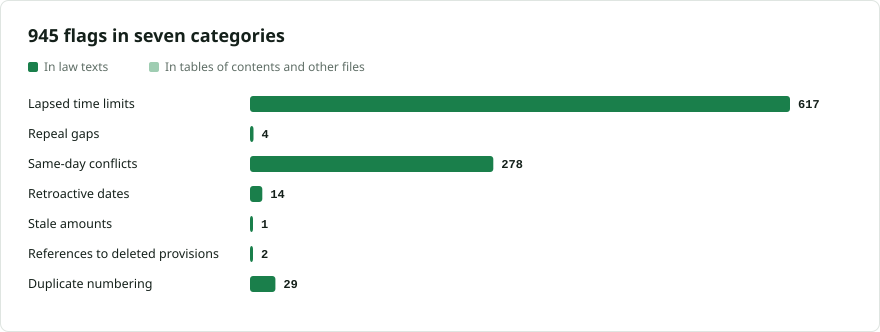

# Vulnerabilities in Norwegian law

[Norsk bokmål](README.md) · **English**

<picture>
<source media="(prefers-color-scheme: dark)" srcset="img/flags-by-category-dark.svg">

</picture>

The vulnerability detectors from [lexifina/global-law](https://github.com/lexifina/global-law/tree/main/vulnerabilities) look for mechanical mistakes in legislation: a rule applying "until" a date that has passed, a time limit extended only after it had run out, a provision repealed before its replacement took effect, an amount changed in one place but still standing in another, a reference to a section that no longer exists. global-law's published list (9 November 2026) covered Norway with 20 flags: 6 same-day conflicts, all in the Inheritance Act (arveloven) on 1 January 2021, and 14 retroactive dates, all of them decisions amending the Constitution. This is a run over this repository only, the Constitution and 4,090 other acts, as it stood at commit [`1f8a1c3`](https://github.com/lexifina/norway-law/commit/1f8a1c380b8089eaffbc9e6fa7954e12bb19d322) on 15 November 2026, with versions in force up to 2 November 2026. It finds 945 flags: the same 14 retroactive dates, 278 same-day conflicts (the 6 in the Inheritance Act among them), and five categories that list did not have for Norway: lapsed time limits (617), duplicate numbering (29), repeal gaps (4), references to deleted provisions (2) and a stale amount (1). For this run the detectors learned Norwegian: "til 31. desember 2020", "inntil", "fram til" and "til utgangen av 2027" as time limits, and sections numbered by chapter ("§ 14-9", "§ 4-1 a").

**In short:** the detectors raised 945 flags. A language model reviewed 101 of the strongest, arguing each one for and against; 5 survived. Checked by hand in this repository, none of them is a mistake in Norwegian law. Four are transitional rules and temporary schemes that have run their course: new approval of animal experiments due by 1 January 2018, adjustment of ground rent until the same day, grants for interrupted lay-offs for periods up to 31 August 2021, and a deadline in the 2018 aquaculture auction. The fifth comes from how this repository is built: the Penal Code of 2005 was amended several times before it took effect on 1 October 2015, and each amendment is a commit dated that day, so a paragraph on retroactivity for chapter 16 that Lov 7. mars 2008 nr. 4 added to § 3, and that the Penal Code's commencement act (Lov 19. juni 2015 nr. 65) took out again, looks as if it took effect and lapsed on one day; it never applied. Reading the flagged provisions turned up one error in this repository's text (§ 5 of the Penal Code, below). Later, this will be formalised in Lean, similar to our work on [the US tax code](https://lexifina.com/blog/formalizing-the-us-tax-code) and [US case law](https://lexifina.com/blog/formalizing-all-us-case-law-in-lean).

A flag is a prompt to look, not legal advice, and nothing here has been tested in court.

## Flags by category

| Category | What it looks for | Flags | In law texts | Reviewed | Survived review |
| --- | --- | ---: | ---: | ---: | ---: |
| Lapsed time limits | Text still applying a rule "until" a date that has passed | 617 | 617 | 40 | 4 |
| Repeal gaps | A provision removed before its replacement took effect | 4 | 4 | 4 | 0 |
| Same-day conflicts | Two acts changing the same provision with the same in-force day | 278 | 278 | 40 | 1 |
| Retroactive or pre-publication dates | A change taking effect before it was announced | 14 | 14 | 14 | 0 |
| Stale amounts | An amount changed in one place but still standing elsewhere | 1 | 1 | 1 | 0 |
| References to deleted provisions | A provision citing a section that no longer exists | 2 | 2 | 2 | 0 |
| Duplicate numbering | Two units with the same number in one provision | 29 | 29 | 0 | 0 |

"In law texts" counts every file of the Constitution and of the 4,090 other acts, the amending acts among them, so every flag is in a law text. Not law are the root files, `data/`, `tools/` and the `README.md` in each act's folder, which lists its provisions; none of them has a flag. Every provision is a file here, but only the Constitution and the 29 replayed laws have their full history; the 4,061 acts held with their current text only have one commit each. The history detectors (repeal gaps, same-day conflicts, empty periods, stale amounts, references to deleted provisions) therefore see changes in those 31 laws only, and in the whole history just 37 files are deleted. Lovdata's editorial "(Opphevet ...)" lines are left out, so a repealed section is a deleted file rather than a placeholder, and no reference to a repealed placeholder was found. The commits give both the day a change took effect and the day it was announced; only the decisions amending the Constitution, which take effect when Stortinget adopts them, come before their announcement. No empty periods, dead currencies, publisher notes or dead fines were found.

*Edge cases: the 5 flags that survived the review, grouped by what they turned out to be, and what the other flags are, in [EDGE-CASES.en.md](EDGE-CASES.en.md).*

## Problems found in this repository

- **Section 5 of the Penal Code out of order:** [`straffeloven/paragraf-005.md`](https://github.com/lexifina/norway-law/blob/1f8a1c380b8089eaffbc9e6fa7954e12bb19d322/straffeloven/paragraf-005.md) reads "Utenfor virkeområdet etter § 4 gjelder straffelovgivningen for handlinger foretattnår handlingene:", followed by letters a to c and numbers 1 to 13. In Lovdata's text, letters a to c (who committed the act) stand between "foretatt" and "når handlingene:"; here they have moved after the opening words, which have run together. The text has read so in every version since the act's first text ([the commit](https://github.com/lexifina/norway-law/commit/ea9b3a3eff3e724a6e37359a83cb975a2eda6d05)); the words are all there, but the sentence does not read as enacted. Other places with the same fault were not searched for systematically.

## Files

| File | What it holds |
| --- | --- |
| [data/flags.csv](data/flags.csv) | Every flag, one row per provision and issue |
| [data/reviewed.csv](data/reviewed.csv) | The 101 flags the model reviewed, with its verdict and reason |
| [data/by_category.csv](data/by_category.csv) | The counts in the table above |
| [tools/](tools/) | The scripts that made this run |

Columns: `category` and `category_nb` (the category in English and Norwegian), `detector`, `kind` (`law` or `other`), `path` (the provision in this repository), `date` (the date the flag turns on), `reference` (the act or line involved), `summary`, `score` (the detector's ranking, 0 to 1), `review` (`artefact`, `lawful` or `candidate_defect`), `survives_rebuttal`, `review_note` (the model's reason, in English), `url` (the provision at the commit that was read, or, for a provision removed since, at the last commit that held it).

## How it was made

- **Detectors:** global-law's [vulnerabilities/scripts](https://github.com/lexifina/global-law/tree/main/vulnerabilities/scripts), with the fixes in [tools/patch_detectors.py](tools/patch_detectors.py) and the Norwegian ones in [tools/patch_nb.py](tools/patch_nb.py), run on this repository at commit `1f8a1c3`. The history table the detectors read was built from this repository's own commits (the act that made each change and its `In-force` date); all 4,575 dated commits count as law: 549 changes (`Kind: law`) and the 4,026 first texts of the current-text acts (`Kind: publisher`). The Norwegian fixes: the search for time limits reads "til", "inntil", "fram til" and the end of a year ("til utgangen av 2027"), where only "frem til" and "til og med" were read (lapsed time limits from 241 to 617); "innen" and "senest" (by, at the latest) are deadlines and stay unread, as in the other languages. The search for references reads sections numbered by chapter ("§ 14-9", "§ 1a-1", "§ 4-1 a") and inserted sections ("§ 6 a"), which it had read as § 14, § 1a, § 4 and § 6, and the file names give the same keys (`paragraf-14-009.md` is § 14-9); another act named before the section ("barnelova § 3", "lov 17. juni 2005 nr. 62 § 7") or after it ("§ 3 i lov om ...") is not the act's own (references to deleted provisions stayed at 2). The search for duplicate numbers no longer reads § 3-1 and § 3-2 as two units "§ 3", nor an amending act's instructions ("§ 10 annet ledd skal lyde:") as units (from 159 to 29).
- **Model review:** gpt-5.4-mini, the 40 strongest flags per category; every flag is in a law text, so the 40 strongest lapsed time limits in law texts are the same 40. One pass says whether a flag is real, a second argues that it is not. There were no empty periods to review. The model does not review the last category. global-law's own list used a different model.
- **Hand check:** every flag that survived was read in this repository's history and texts, with the amending act's text where the repository holds it. The four repeal gaps, the stale amount, both references to deleted provisions and all 29 duplicate numbers were read, as were samples of the lapsed time limits and the same-day conflicts. Section 5 of the Penal Code was compared with Lovdata's text; the amending acts in Norsk Lovtidend were not read beyond what this repository holds.

To report a correction, open an issue with the provision and an official source.

## Licence

The lists and notes are Lexifina's, dedicated to the public domain under CC0 1.0 like this repository's history, tables and tools. Quoted law text is from Lovdata's open data under the Norwegian licence for Open Government data (NLOD 2.0): "Contains data under the Norwegian licence for Open Government data (NLOD) distributed by Lovdata". Laws and decisions of public authorities are not protected by copyright in Norway (åndsverkloven § 14), and the official text is the one announced in Norsk Lovtidend. See [LICENSE](../LICENSE).
