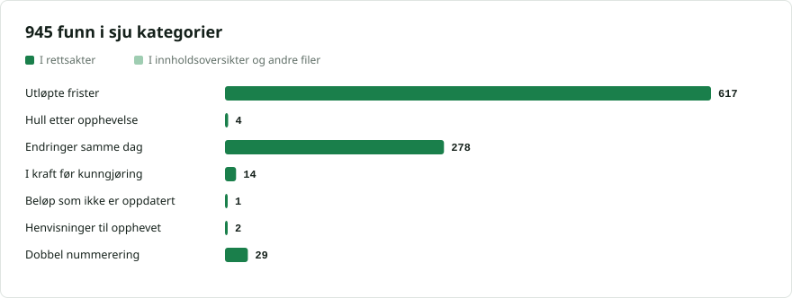

# Sårbarheter i norsk lovgivning

**Norsk bokmål** · [English](README.en.md)

<picture>
<source media="(prefers-color-scheme: dark)" srcset="img/flags-by-category-dark.nb.svg">

</picture>

Sårbarhetsdetektorene i [lexifina/global-law](https://github.com/lexifina/global-law/tree/main/vulnerabilities) leter etter mekaniske feil i lovgivningen: en regel som gjelder «til» en dato som er passert, en frist som forlenges først etter at den har løpt ut, en bestemmelse som oppheves før den som skal avløse den, har trådt i kraft, et beløp som endres ett sted, men blir stående et annet, og en henvisning til en paragraf som ikke lenger finnes. Listen global-law publiserte 9. november 2026, omfattet Norge med 20 funn: 6 endringer samme dag, alle i arveloven 1. januar 2021, og 14 tilfeller av ikrafttredelse før kunngjøring, alle grunnlovsvedtak. Her er detektorene kjørt på dette repositoriet alene, Grunnloven og 4 090 andre rettsakter, slik det sto i commit [`1f8a1c3`](https://github.com/lexifina/norway-law/commit/1f8a1c380b8089eaffbc9e6fa7954e12bb19d322) 15. november 2026, med versjoner som trådte i kraft til og med 2. november 2026. De gir 945 funn: de samme 14 grunnlovsvedtakene, 278 endringer samme dag (blant dem de 6 i arveloven) og fem kategorier som listen ikke hadde for Norge: utløpte frister (617), dobbel nummerering (29), hull etter opphevelse (4), henvisninger til opphevede bestemmelser (2) og et beløp som ikke er oppdatert (1). Til denne kjøringen lærte detektorene norsk: «til 31. desember 2020», «inntil», «fram til» og «til utgangen av 2027» som tidsgrenser, og paragrafer som er nummerert etter kapittel («§ 14-9», «§ 4-1 a»).

**Kort sagt:** Detektorene ga 945 funn. En språkmodell vurderte 101 av de sterkeste og førte argumenter for og mot hvert av dem; 5 sto seg. Kontrollert for hånd i dette repositoriet er ingen av dem en feil i norsk lovgivning. Fire er overgangsregler og midlertidige ordninger som har utspilt sin rolle: ny godkjenning av dyreforsøk innen 1. januar 2018, regulering av festeavgift fram til samme dag, tilskudd ved avbrutt permittering for perioder til og med 31. august 2021 og en frist i akvakulturauksjonen i 2018. Det femte skyldes hvordan repositoriet er bygget: straffeloven 2005 ble endret flere ganger før den trådte i kraft 1. oktober 2015, og hver endring er en commit med den datoen. Et ledd om tilbakevirkning for kapittel 16 som lov 7. mars 2008 nr. 4 føyde til i § 3, og som straffelovens ikraftsettingslov (lov 19. juni 2015 nr. 65) tok ut igjen, ser derfor ut til å ha trådt i kraft og falt bort samme dag; det gjaldt aldri. Gjennomlesningen av bestemmelsene med funn avdekket én feil i teksten i dette repositoriet (straffeloven § 5, se nedenfor). Senere skal dette formaliseres i Lean, på samme måte som vårt arbeid med [den amerikanske skatteloven](https://lexifina.com/blog/formalizing-the-us-tax-code) og [amerikansk rettspraksis](https://lexifina.com/blog/formalizing-all-us-case-law-in-lean).

Et funn er en grunn til å se nærmere etter, ikke juridisk rådgivning, og ingenting her er prøvd for en domstol.

## Funn etter kategori

| Kategori | Hva det letes etter | Funn | I rettsakter | Vurdert | Sto seg |
| --- | --- | ---: | ---: | ---: | ---: |
| Utløpte frister | Tekst som fortsatt lar en regel gjelde «til» en dato som er passert | 617 | 617 | 40 | 4 |
| Hull etter opphevelse | En bestemmelse som falt bort før den som skulle avløse den, trådte i kraft | 4 | 4 | 4 | 0 |
| Endringer samme dag | To lover som endrer samme bestemmelse med samme ikrafttredelsesdag | 278 | 278 | 40 | 1 |
| Ikrafttredelse før kunngjøring | En endring som trer i kraft før den er kunngjort | 14 | 14 | 14 | 0 |
| Beløp som ikke er oppdatert | Et beløp som er endret ett sted, men fortsatt står et annet sted | 1 | 1 | 1 | 0 |
| Henvisninger til opphevede bestemmelser | En bestemmelse som viser til en paragraf som ikke lenger finnes | 2 | 2 | 2 | 0 |
| Dobbel nummerering | To enheter med samme nummer i én bestemmelse | 29 | 29 | 0 | 0 |

«I rettsakter» teller hver fil i Grunnloven og i de 4 090 andre rettsaktene, endringslovene medregnet, så hvert funn står i en rettsakt. Ikke lovtekst er filene i rotmappen, `data/`, `tools/` og `README.md` i mappen til hver rettsakt, som lister opp bestemmelsene; ingen av dem har funn. Hver paragraf er en egen fil her, men bare Grunnloven og de 29 avspilte lovene har hele historikken; de 4 061 rettsaktene med bare gjeldende tekst har én commit hver. Detektorene for historikk (hull etter opphevelse, endringer samme dag, tomme perioder, beløp som ikke er oppdatert og henvisninger til opphevede bestemmelser) ser derfor bare endringer i disse 31 lovene, og i hele historikken er bare 37 filer slettet. Lovdatas redaksjonelle «(Opphevet ...)»-linjer er utelatt, så en opphevet paragraf er en slettet fil og ikke en plassholder, og ingen henvisning til en bestemmelse som lyder «Opphevet», ble funnet. Commitene oppgir både dagen en endring trådte i kraft, og dagen den ble kunngjort; bare grunnlovsvedtakene, som trer i kraft når Stortinget treffer dem, kommer før kunngjøringen. Det ble ikke funnet tomme perioder, avskaffede valutaer, merknader fra utgiveren eller straffebud uten gjerningsbeskrivelse.

*Grensetilfeller: de 5 funnene som sto seg i vurderingen, gruppert etter hva de viste seg å være, og hva de øvrige funnene er, i [EDGE-CASES.md](EDGE-CASES.md).*

## Problemer funnet i dette repositoriet

- **Straffeloven § 5 i feil rekkefølge:** [`straffeloven/paragraf-005.md`](https://github.com/lexifina/norway-law/blob/1f8a1c380b8089eaffbc9e6fa7954e12bb19d322/straffeloven/paragraf-005.md) lyder «Utenfor virkeområdet etter § 4 gjelder straffelovgivningen for handlinger foretattnår handlingene:», fulgt av bokstav a til c og nr. 1 til 13. I Lovdatas tekst står bokstav a til c (hvem handlingen er foretatt av) mellom «foretatt» og «når handlingene:»; her er de flyttet etter innledningen, og ordene er skrevet sammen. Teksten har sett slik ut i hver versjon siden lovens første tekst ([commiten](https://github.com/lexifina/norway-law/commit/ea9b3a3eff3e724a6e37359a83cb975a2eda6d05)); alle ordene er med, men setningen leses ikke slik den ble vedtatt. Det er ikke søkt systematisk etter andre steder med samme feil.

## Filer

| Fil | Innhold |
| --- | --- |
| [data/flags.csv](data/flags.csv) | Hvert funn, én rad per bestemmelse og forhold |
| [data/reviewed.csv](data/reviewed.csv) | De 101 funnene modellen vurderte, med konklusjon og begrunnelse |
| [data/by_category.csv](data/by_category.csv) | Tallene i tabellen ovenfor |
| [tools/](tools/) | Skriptene som laget denne kjøringen |

Kolonner: `category` og `category_nb` (kategorien på engelsk og norsk), `detector`, `kind` (`law` eller `other`), `path` (bestemmelsen i dette repositoriet), `date` (datoen funnet gjelder), `reference` (rettsakten eller linjen det gjelder), `summary`, `score` (detektorens rangering, 0 til 1), `review` (`artefact`, `lawful` eller `candidate_defect`), `survives_rebuttal`, `review_note` (modellens begrunnelse, på engelsk), `url` (bestemmelsen i commiten som ble lest, eller, for en bestemmelse som senere er fjernet, i den siste commiten som hadde den).

## Slik ble det laget

- **Detektorer:** global-laws [vulnerabilities/scripts](https://github.com/lexifina/global-law/tree/main/vulnerabilities/scripts) med rettelsene i [tools/patch_detectors.py](tools/patch_detectors.py) og de norske i [tools/patch_nb.py](tools/patch_nb.py), kjørt på dette repositoriet i commit `1f8a1c3`. Historikktabellen detektorene leser, ble bygget fra dette repositoriets egne commits (rettsakten som gjorde hver endring, og `In-force`-datoen); alle 4 575 daterte commits regnes som lov: 549 endringer (`Kind: law`) og de 4 026 første tekstene til rettsaktene med bare gjeldende tekst (`Kind: publisher`). De norske rettelsene: Søket etter tidsgrenser leser «til», «inntil», «fram til» og slutten av et år («til utgangen av 2027»), der bare «frem til» og «til og med» ble lest før (utløpte frister fra 241 til 617); «innen» og «senest» er frister og leses fortsatt ikke, som på de andre språkene. Søket etter henvisninger leser paragrafer nummerert etter kapittel («§ 14-9», «§ 1a-1», «§ 4-1 a») og innskutte paragrafer («§ 6 a»), som det leste som § 14, § 1a, § 4 og § 6, og filnavnene gir de samme nøklene (`paragraf-14-009.md` er § 14-9); en annen lov som nevnes foran paragrafen («barnelova § 3», «lov 17. juni 2005 nr. 62 § 7») eller etter den («§ 3 i lov om ...»), er ikke rettsaktens egen (henvisninger til opphevede bestemmelser ble stående på 2). Søket etter dobbel nummerering leser ikke lenger § 3-1 og § 3-2 som to enheter «§ 3», og heller ikke en endringslovs instrukser («§ 10 annet ledd skal lyde:») som enheter (fra 159 til 29).
- **Modellvurdering:** gpt-5.4-mini, de 40 sterkeste funnene i hver kategori; hvert funn står i en rettsakt, så de 40 sterkeste utløpte fristene i rettsakter er de samme 40. En første runde avgjør om et funn er reelt, en annen argumenterer for at det ikke er det. Det var ingen tomme perioder å vurdere. Modellen vurderer ikke den siste kategorien. global-laws egen liste ble laget med en annen modell.
- **Kontroll for hånd:** Hvert funn som sto seg, ble lest i dette repositoriets historikk og tekster, med endringslovens tekst der repositoriet har den. De fire hullene etter opphevelse, beløpet, begge henvisningene til opphevede bestemmelser og alle de 29 tilfellene av dobbel nummerering ble lest, i tillegg til stikkprøver av de utløpte fristene og endringene samme dag. Straffeloven § 5 ble sammenlignet med Lovdatas tekst; endringslovene i Norsk Lovtidend ble ikke lest utover det dette repositoriet har.

Rettelser kan meldes som en issue med bestemmelsen og en offisiell kilde.

## Lisens

Listene og merknadene er Lexifinas og er, som historikken, tabellene og verktøyene i dette repositoriet, frigitt til allmennheten under CC0 1.0. Sitert lovtekst er fra Lovdatas åpne data under norsk lisens for offentlige data (NLOD 2.0): «Inneholder data under norsk lisens for offentlige data (NLOD) tilgjengeliggjort av Lovdata». Lover og vedtak av offentlige myndigheter er ikke vernet av opphavsrett i Norge (åndsverkloven § 14), og den offisielle teksten er den som er kunngjort i Norsk Lovtidend. Se [LICENSE](../LICENSE).
